# Propuestas visuales de Iluikali

Imágenes generadas durante la exploración del diseño. Se conservaron los originales completos, sin recortar ni editar. La dirección elegida es **80s tech**; las variantes Apple anteriores se guardan como historial.

## Páginas

- `01-inicio/`: evolución del inicio; `04-tech-80s-seleccionado.png` es la versión elegida.
- `02-tripulante/`: pantalla de indicadores.
- `03-detalle/`: detalle de sueño y láminas de las demás métricas.
- `04-widgets/`: balance circadiano y fases de sueño.
- `05-paginas-agrupadas/`: mapa conjunto de inicio y categorías.
- `06-estados-y-acciones/`: lámina con actividad, laboratorio y estados de la interfaz.

## Límites de las propuestas

Son bocetos generados, no capturas del frontend ni datos reales. Las láminas agrupadas contienen rótulos repetidos o incorrectos, cifras ilustrativas y algunos elementos que difieren del layout elegido. No deben usarse como especificación clínica o de datos. Conservar la navegación, las unidades y los textos verificados al implementarlas.

`manifest.json` relaciona cada copia con su archivo original y su SHA-256.

## Galería

### Inicio: primera propuesta Apple

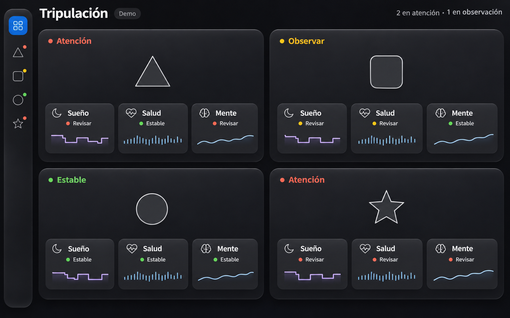

### Inicio: variante simplificada

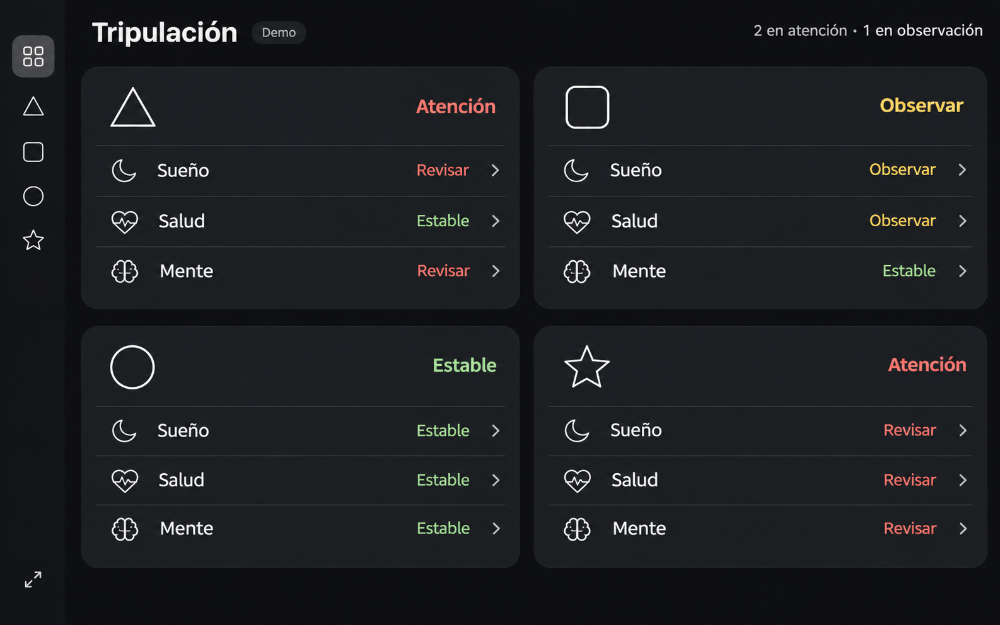

### Inicio: avatar y tipografía

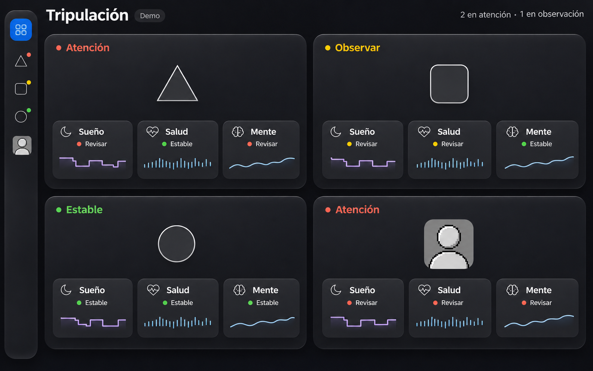

### Inicio: dirección 80s elegida

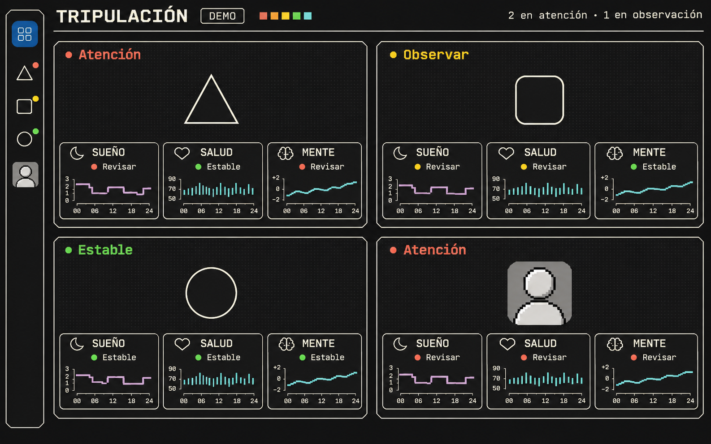

### Tripulante: indicadores de sueño y energía

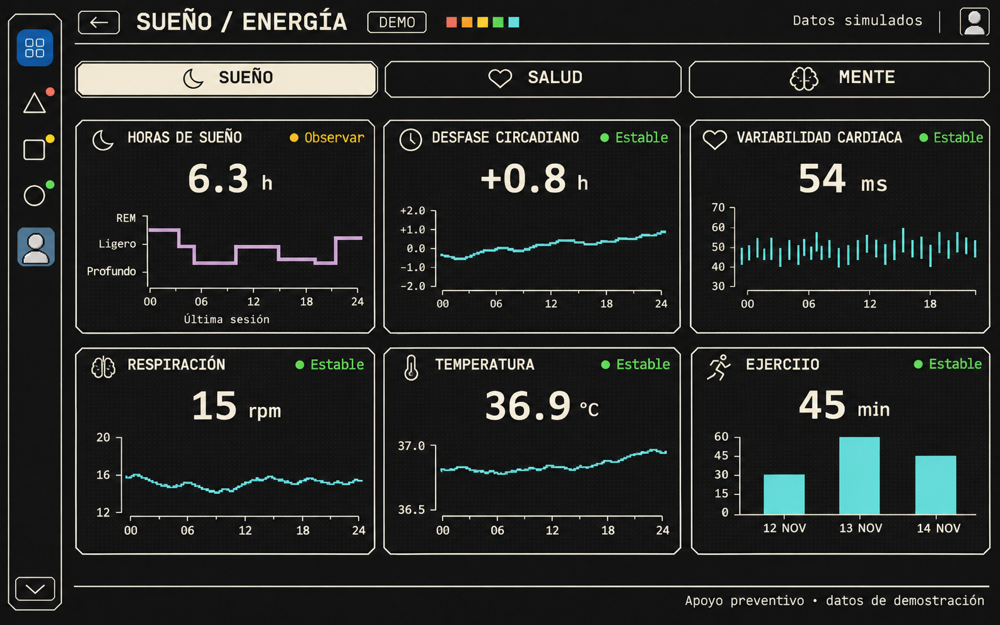

### Detalle: horas de sueño

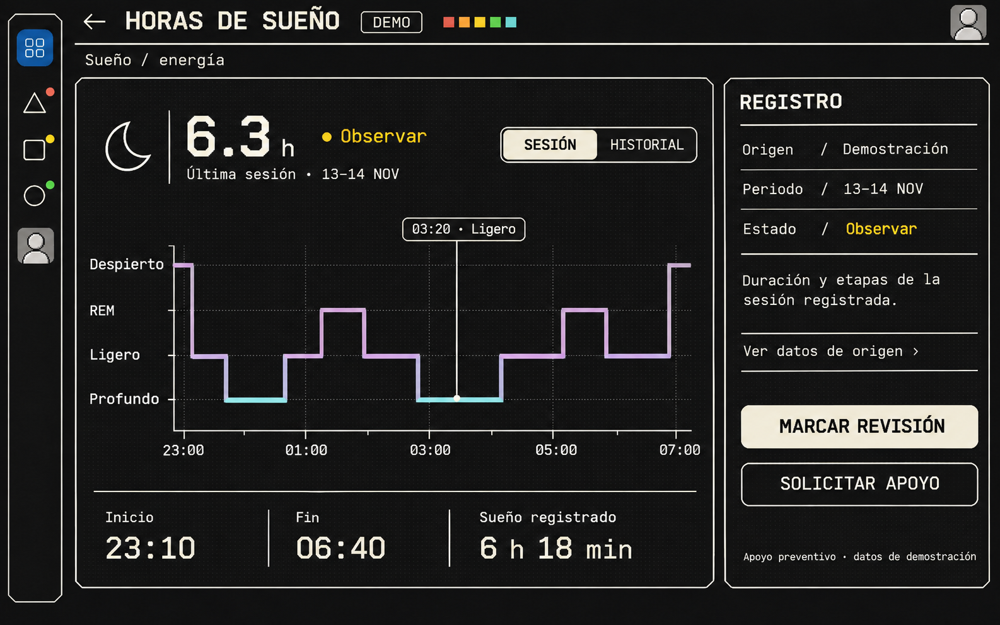

### Widget: balance circadiano con sol y luna

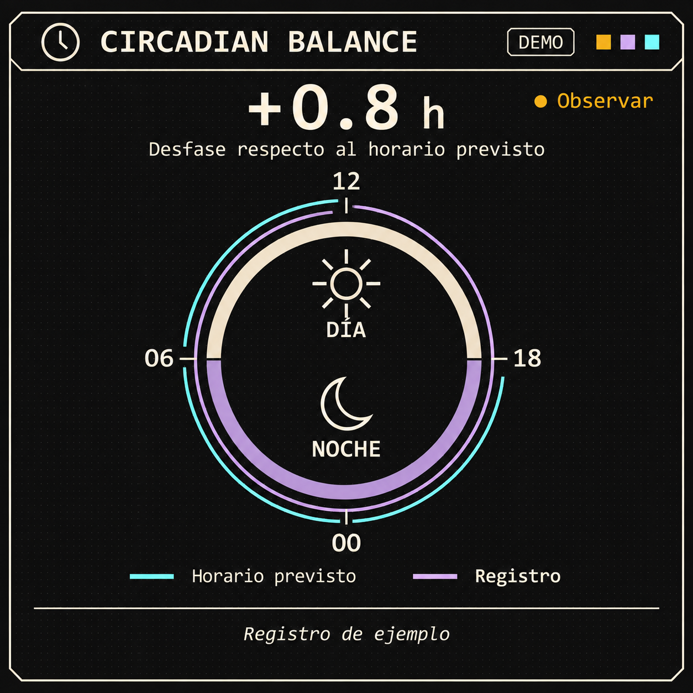

### Widget: REM y fases del sueño

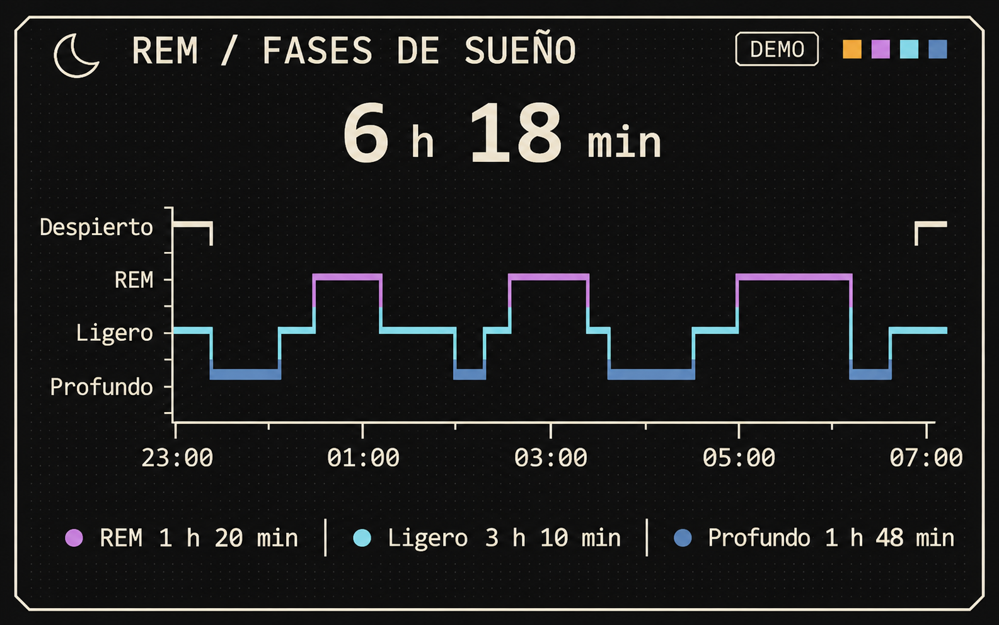

### Lámina: inicio y tres categorías

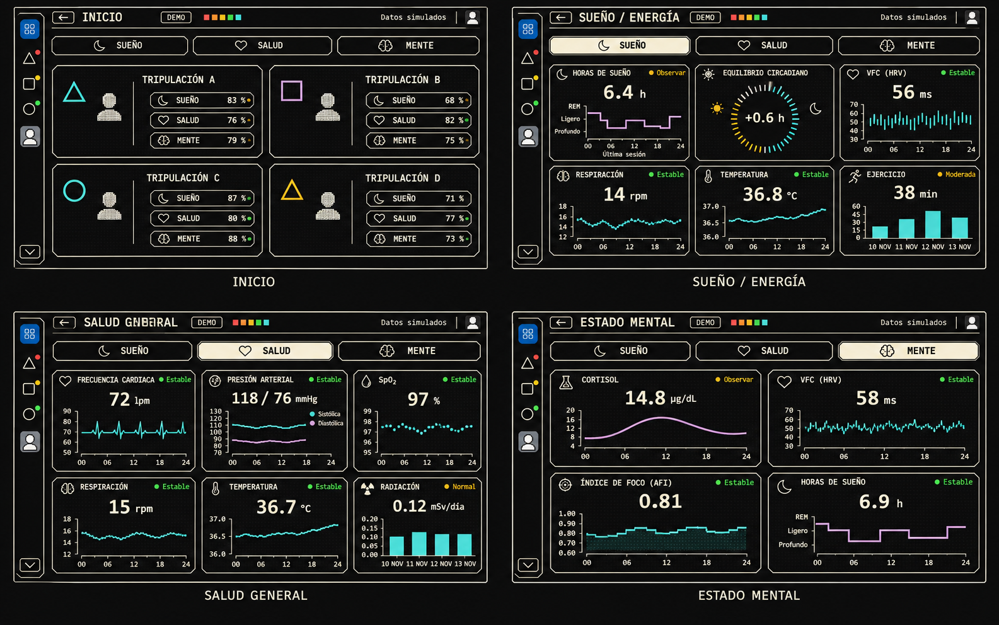

### Lámina: seis detalles de salud general

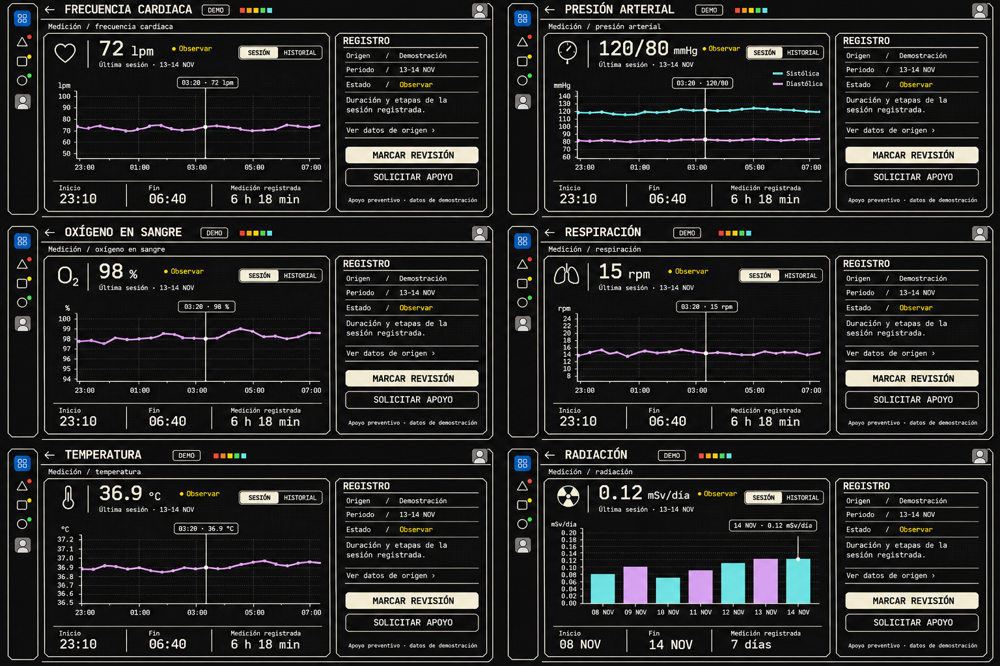

### Lámina: sueño, circadiano, HRV, cortisol y AFI

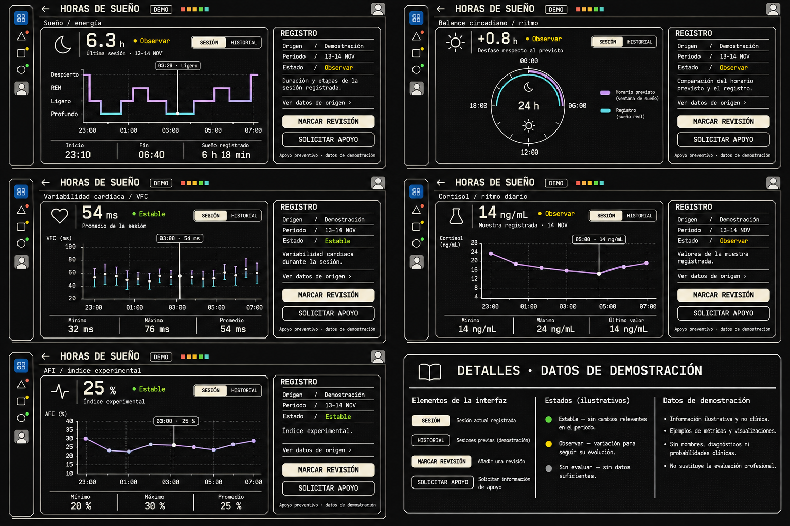

### Lámina: actividad, laboratorio, importación, apoyo y error

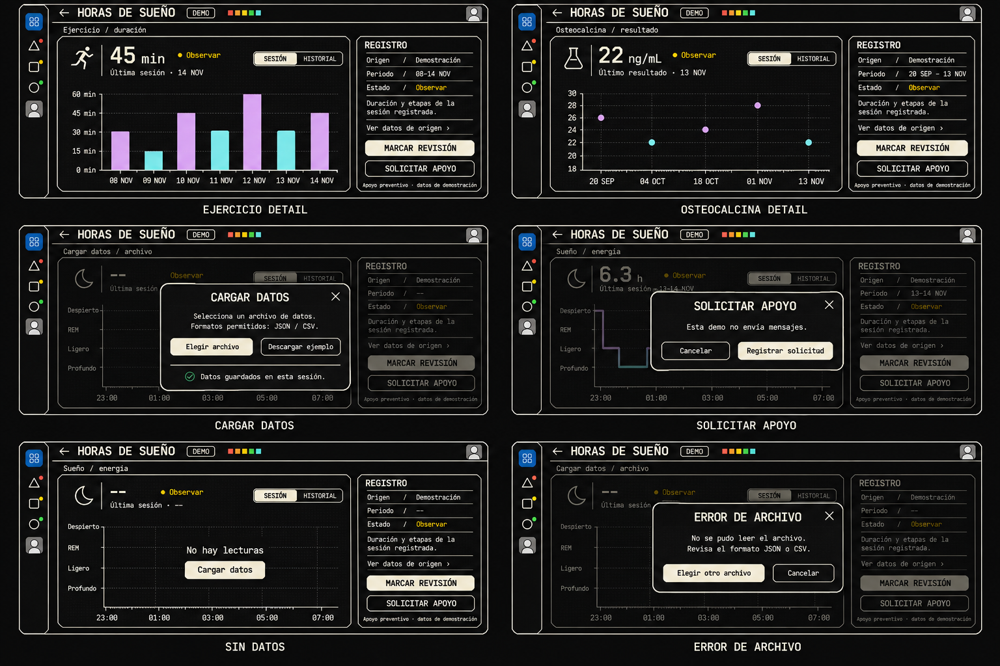

